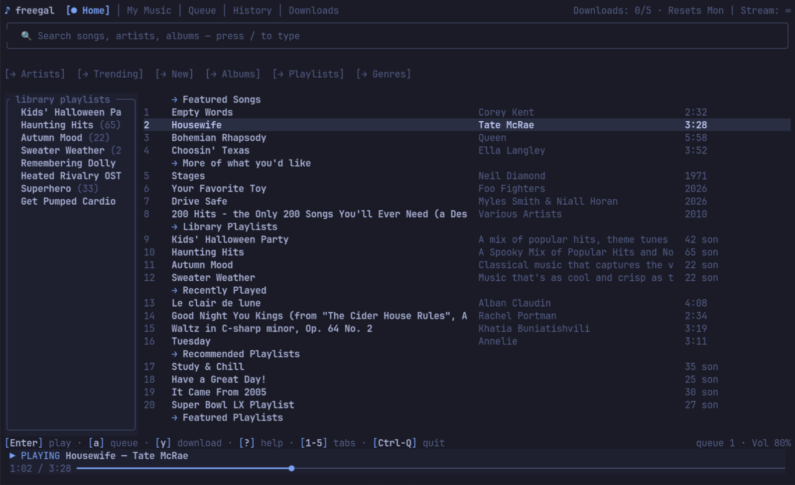

# freegal

[](https://github.com/icyavocado/freegal-tui/actions/workflows/ci.yml)
[](LICENSE)
[](https://www.rust-lang.org)
[](https://mpv.io)

A terminal client for [Freegal Music](https://www.freegalmusic.com) — the
library-card music streaming and download service many public libraries
subscribe to. Built with Rust + ratatui, plays through mpv.

Log in with your library's website address, card number and PIN, then search,
stream, and use your weekly download credits — all from the terminal.

## Contents

- [Interface](#interface)
- [Features](#features)
- [Build & run](#build--run)
- [Keys](#keys)
- [Ethical use](#ethical-use-only)
- [Docs](#docs)
- [License](#license)

## Interface

The Home dashboard — real session, signed in and playing:



## Features

- **Search** — songs, artists, albums, with best-match sorting (or title/artist A→Z)
- **Home dashboard** — featured songs, "more of what you'd like", library
  playlists, recently played, featured/recommended/trending playlists,
  featured artists, new albums; quick links into genres, trending, arrivals
- **Genres** — A→Z genre browser with color-coded chips, subgenre filtering,
  per-genre songs / playlists / albums / artists
- **My Music** — your playlists, downloaded songs, favorites and wishlist
- **Streaming** — now-playing bar with click-to-seek, queue (play now / next /
  append), loop-one, gapless auto-advance, audio output picker
- **Downloads** — credit-aware with a confirmation dialog, redownload support,
  persistent song list
- **History** — persistent, filterable, drives recommendations
- **Caching** — a 30-minute catalog cache and stream-ticket reuse, so browsing
  is fast and the API sees human-pace traffic
- **Mouse support** — click rows, tabs, quick links, breadcrumbs, the progress bar

## Build & run

Requires Rust (1.88+) and [mpv](https://mpv.io) on your PATH. Linux only.

```sh
cargo build --release
./target/release/freegal
```

First run walks you through a login wizard: library website (e.g.
`https://<your-library>.freegalmusic.com/`), card number, PIN.
Credentials are stored in `~/.config/freegal/creds.toml` (0600) and reused for
silent re-login. Logs go to `~/.local/state/freegal/freegal.log`.

## Keys

| Key | Action |
| --- | --- |
| `Tab` / `s m q d h` / `1`-`5` | switch tabs (1 Home, 2 My Music, 3 Queue, 4 History, 5 Downloads) |
| `/` | focus the search box (filter box on History) |
| `Enter` | play song / drill into artist, album (in album and library lists the rest of the list is queued after the picked song) |
| `a` / `A` | append to queue / play next |
| `y` | download (spends 1 credit after confirm) |
| `S` | cycle result sort (best match / title A→Z / title Z→A / artist A→Z) |
| `D` | clear play history (confirm dialog, History tab) |
| `R` | refetch Home feeds / retry failed search |
| `Esc` | back one level; with a query, clear it — back to the dashboard |
| `Space` , `n` / `p` | play-pause, next / previous |
| `,` / `.` , `-` / `+` | seek ±5s, volume |
| `d`, `J` / `K` | remove, move row (queue) |
| `g` / `G`, arrows / `j` `k` | navigate |
| `?` / `e` | help / error log |
| `o` | audio output picker |
| Mouse | scroll = arrows; click = select row, focus box, or pick a tab; double-click = open; click the progress bar to seek |
| `Backspace` / `Delete` | edit the search box (Backspace from results refocuses it) |
| `Ctrl-Q` / `Ctrl-C` | quit |

Esc always goes back exactly one level (from the search box with a query, it
clears the query and returns to the Home dashboard).

## Ethical use only

Freegal is a licensed service paid for by your library. This client is for
**your own account, at human pace**: one person browsing and queuing downloads
like you would in the web player. The site marks itself `tdm-reservation:
disallowed` / `noai` — no scraping, no bulk automation, no training data.
Downloads are spent one credit at a time behind an explicit confirmation
dialog; nothing downloads implicitly.

## Docs

The Freegal API is undocumented; shapes here were pinned by capturing the
official web player's traffic:

- [`specs/01-api.md`](specs/01-api.md) — every endpoint used, with captured
  response shapes and empty-state codes
- [`specs/02-tui.md`](specs/02-tui.md) — screen layout, keyboard behavior,
  navigation invariants
- [`specs/03-interfaces.txt`](specs/03-interfaces.txt) — the interface
  reference: each surface's screenshot panel plus the design intention behind it
- [`STYLE.md`](STYLE.md) — the UI design system (layout, cues, empty states)
- [`fixtures/capture/`](fixtures/capture/) — raw captured responses backing it all

## License

[MIT](LICENSE)